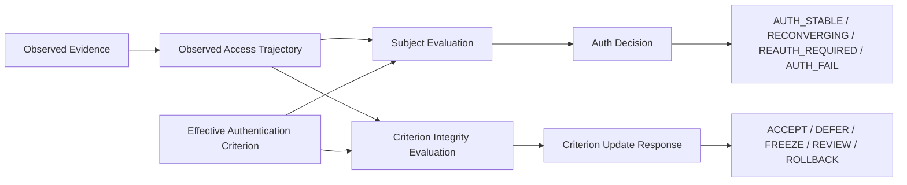
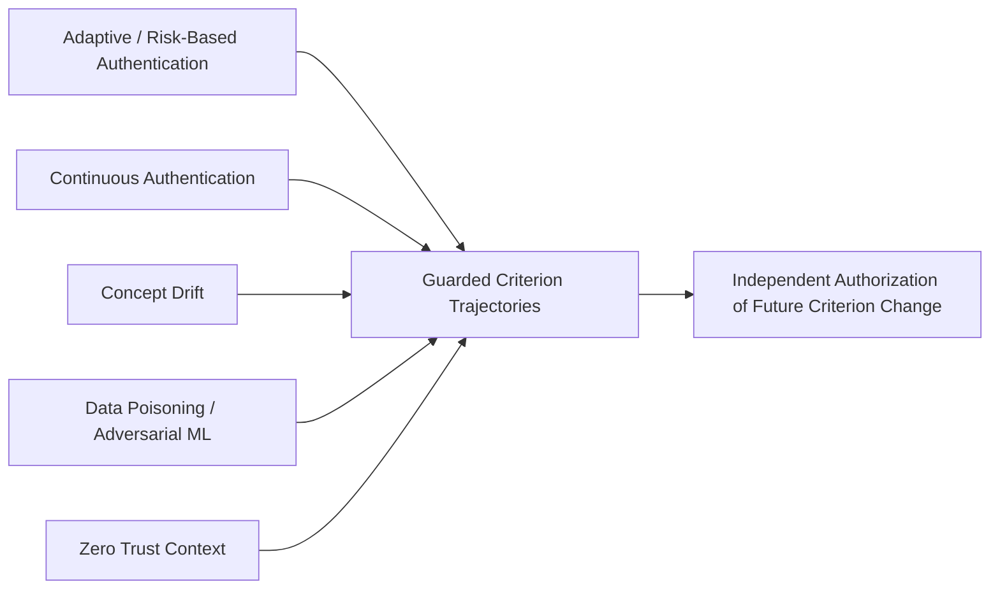
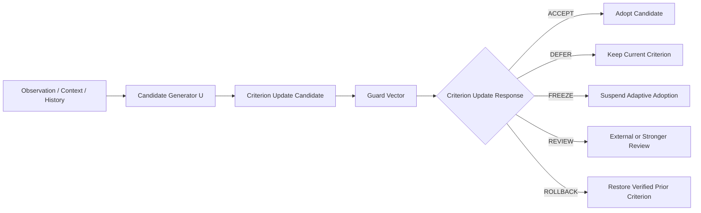
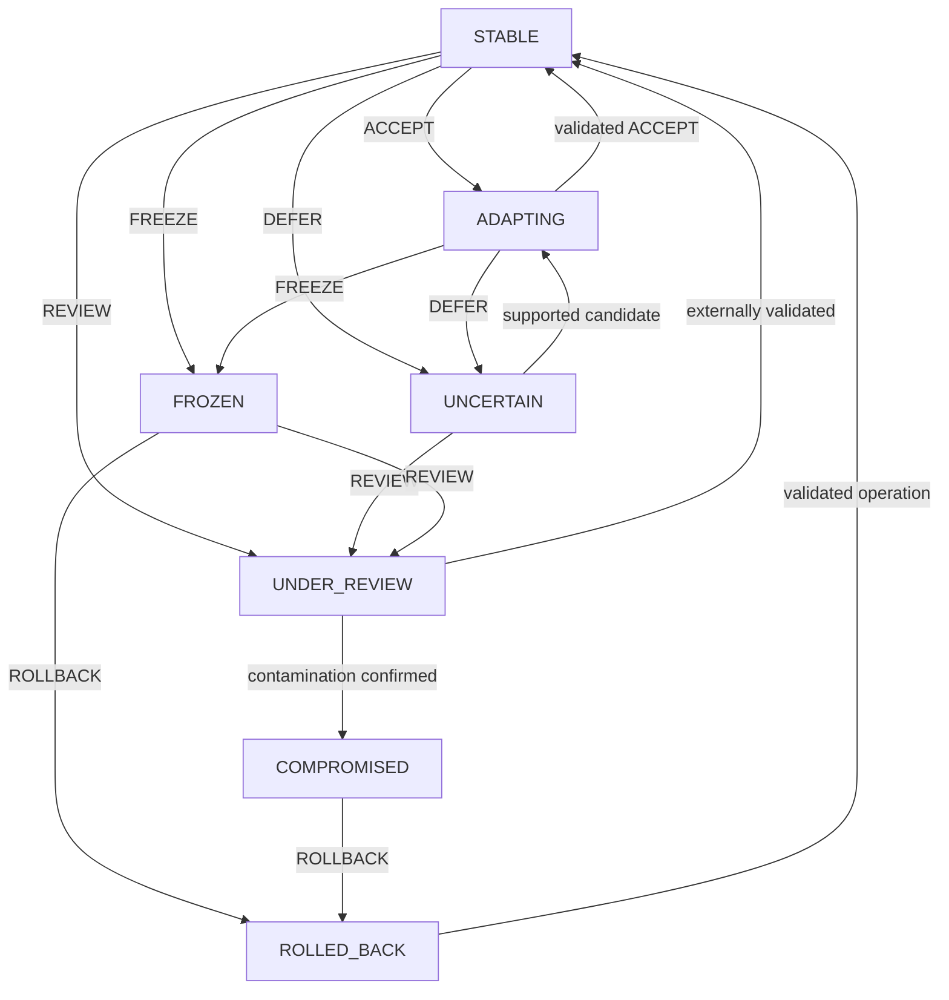
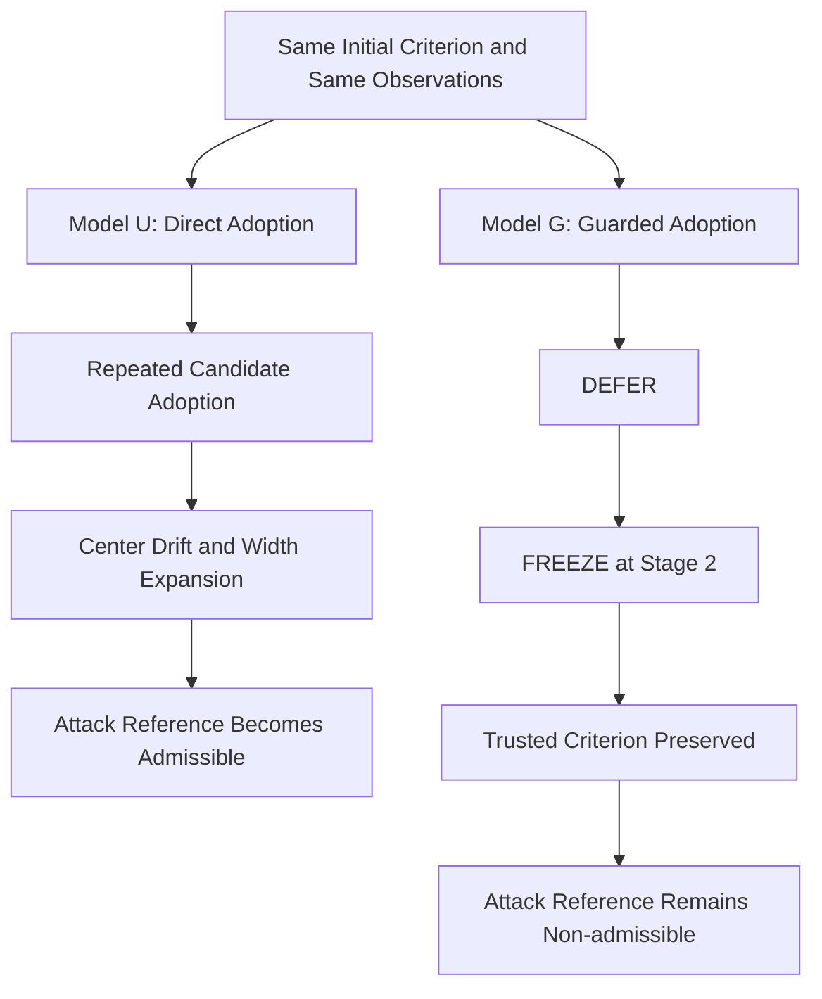
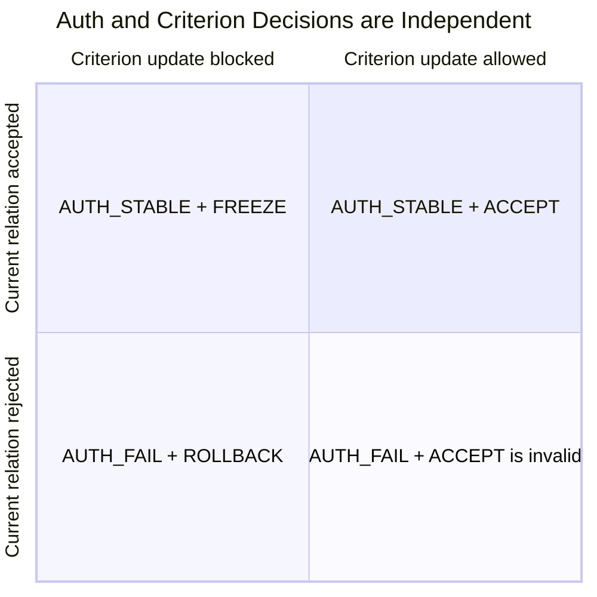

# Guarded Criterion Trajectories — Figure Sources

This file contains the canonical editable Mermaid sources for the submission manuscript.

Figure numbers follow the order in which the figures appear in the English and Japanese publication PDFs. The number in each heading, rendered filename, caption, manuscript reference, and PDF figure sequence must remain identical.

## Figure 1. Dual Evaluation Architecture



**Caption:** GyroAuth evaluates the current Authentication Relation and the integrity of the criterion used for future evaluation as separate but related processes.

## Figure 2. Research Positioning



**Caption:** The proposal is positioned at the intersection of adaptive authentication, continuous authentication, drift handling, and poisoning-aware adaptation.

## Figure 3. Guarded Criterion Update Pipeline



**Caption:** Candidate generation and candidate adoption are separated. Only `ACCEPT` makes the candidate effective.

## Figure 4. Criterion Update State Machine



**Caption:** Criterion States and Criterion Update Responses are distinct. `FREEZE` stops adaptation without necessarily terminating Subject Evaluation.

## Figure 5. P1 Direct versus Guarded Update



**Caption:** Under the implemented P1 scenario, direct adoption expanded the criterion until the attack reference became admissible, while guarded adoption froze adaptation before admission.

## Figure 6. Decision-space Separation



**Caption:** `AUTH_STABLE + FREEZE` represents temporary continuation of the current Authentication Relation while prohibiting criterion adaptation.

## Canonical Publication Order

```text
Figure 1  Dual Evaluation Architecture
Figure 2  Research Positioning
Figure 3  Guarded Criterion Update Pipeline
Figure 4  Criterion Update State Machine
Figure 5  P1 Direct versus Guarded Update
Figure 6  Decision-space Separation
```

## Rendering Notes

For publication:

1. render each figure to SVG, PNG, and PDF;
2. use filenames `figure_1` through `figure_6` according to the canonical publication order above;
3. use consistent typography with the manuscript;
4. preserve monochrome readability;
5. ensure line and label sizes remain legible at single-column width;
6. replace Mermaid-specific styling if required by the submission venue;
7. verify that Figure 6 is supported by the selected Mermaid renderer; if not, redraw it as a conventional 2×2 matrix.
